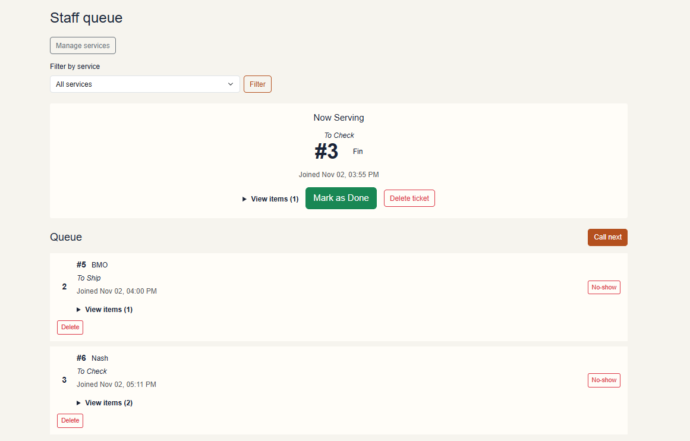
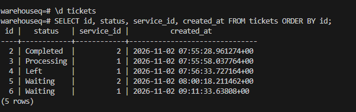
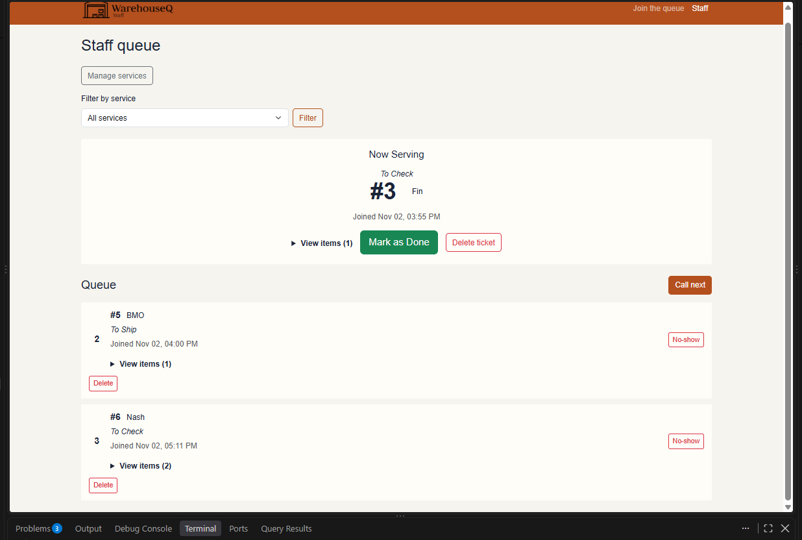
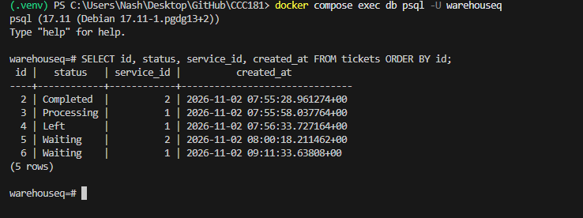

I verified that WarehouseQ's queue data remained available after restarting the database container. I had already completed the clean rebuild test separately and did not repeat the destructive `docker compose down -v` step during this check.

Before the restart, the database contained five tickets across **To Check** and **To Ship**: one **Completed**, one **Processing**, one **Left**, and two **Waiting**. The SQL query showed ticket IDs 2–6, their statuses, service IDs, and creation timestamps:

After restarting the database and returning to the app, the staff dashboard still showed the called ticket and waiting queue. The query returned the same five ticket IDs, statuses, service IDs, and timestamps:

The before-and-after query results match, including the completed, processing, and left states, so the tickets, statuses, and timestamps persisted through the restart. This demonstrates that NFR-01 passed for this test.

The clean rebuild from Part 11b was completed separately: the database was recreated, migrations and seed data were applied, and the app was checked with the seeded services. That destructive test was not repeated for this write-up.
