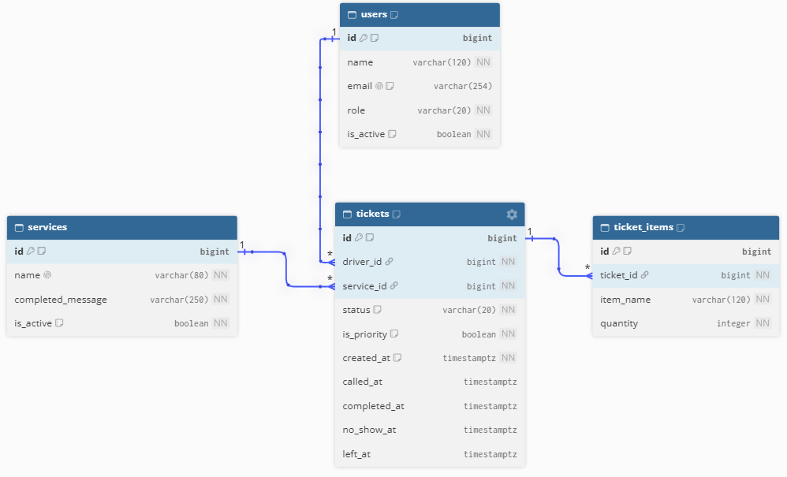
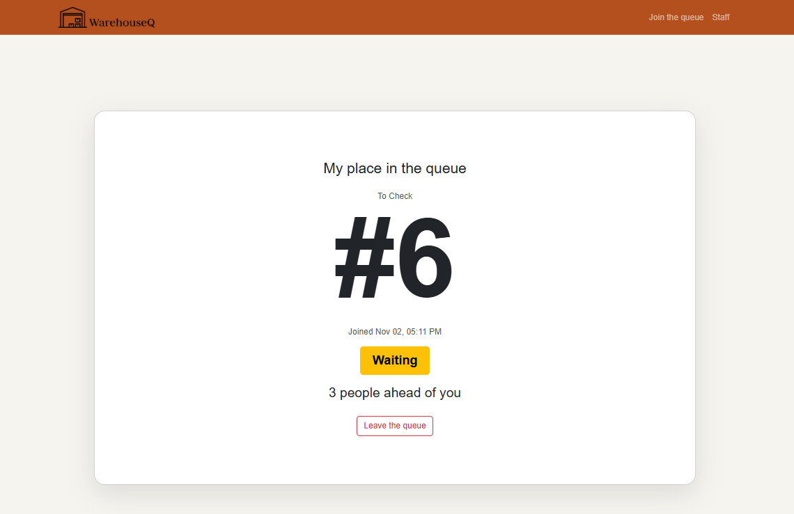
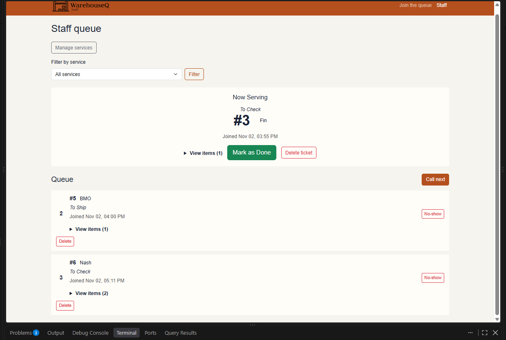
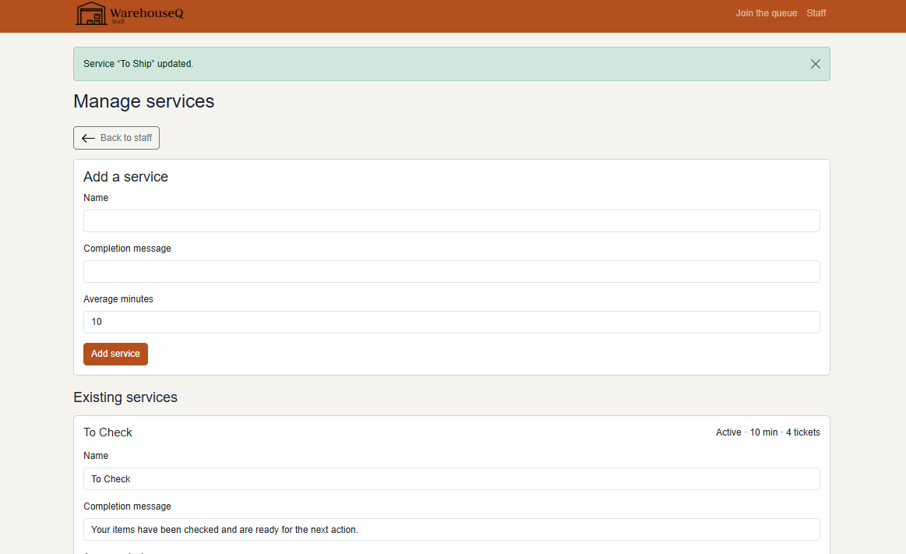
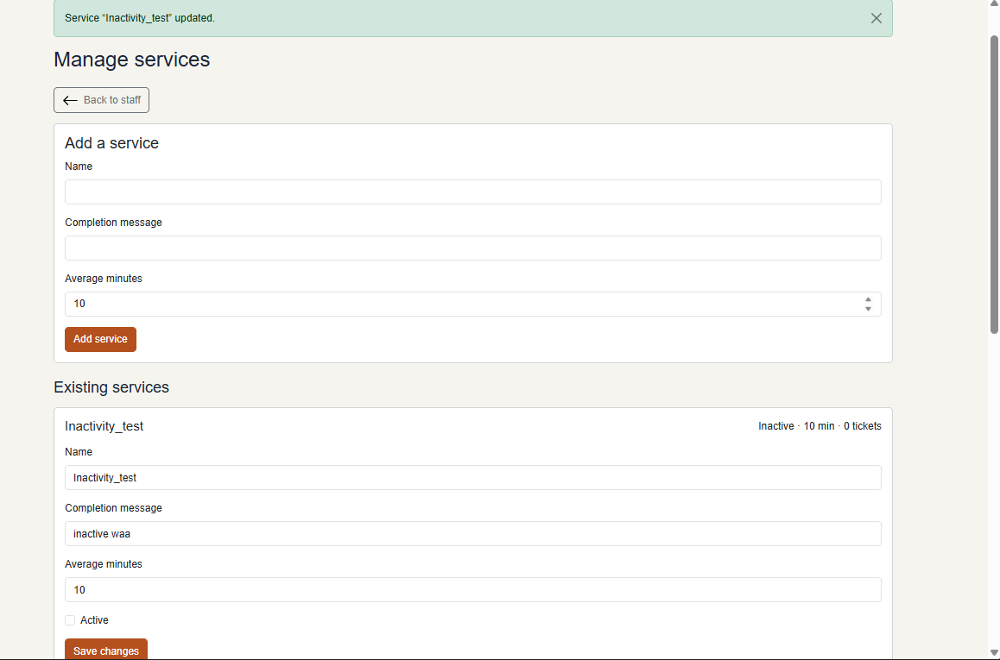
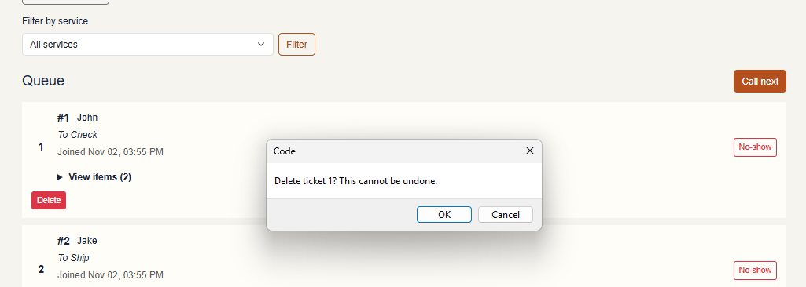
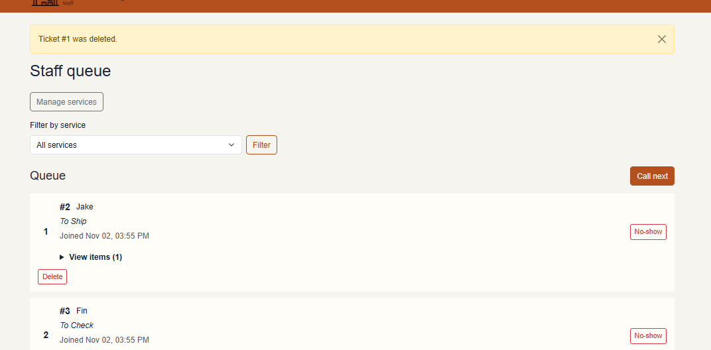
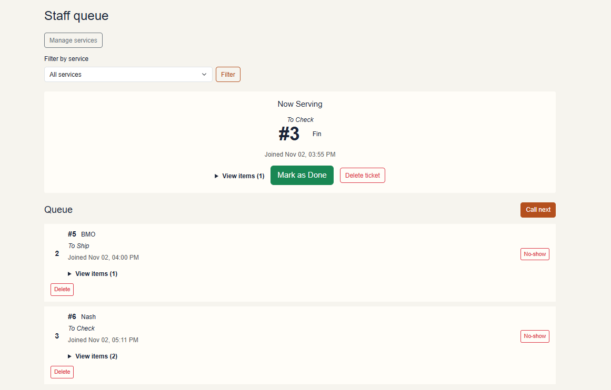
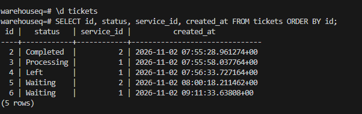
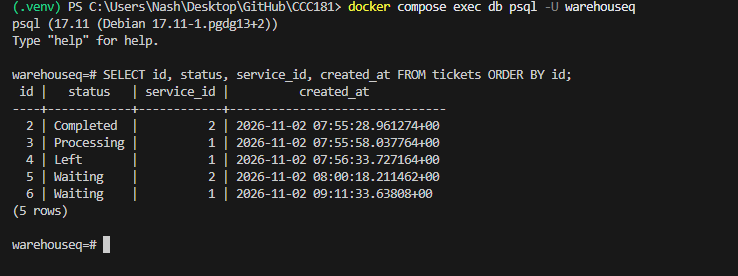

# Week 4 Database Report

## Title details

- **Application:** WarehouseQ
- **Setting:** Warehouse receiving and loading bay during weekday business hours
- **Full name:** Steve Nash H. Llamedo
- **Student ID:** 2024-1070
- **Section:** CS3A
- **Date:** 2 November 2026
- **Branch:** `feature/week4-database`
- **Pull request:** [`Link`](https://github.com/stebbn/CCC181/pull/6)
- **Database:** PostgreSQL in Docker Compose

## Requirements

I wrote 11 functional requirements (REQ-C01–REQ-C05 and REQ-S01–REQ-S06) and five non-functional requirements (NFR-01–NFR-05).

The MVP is REQ-C01, REQ-C02, REQ-C03, REQ-S01, REQ-S02, REQ-S03, and REQ-S04, plus NFR-01, NFR-02, and NFR-05. It lets drivers join the correct service queue and track their tickets while staff identify, call, and process requests in order.

The warehouse delivery driver I consulted wanted to review item names and quantities on their ticket. I added REQ-C04 for reviewing those items. See [the full requirements](../requirements.md).

## ERD



The relationships are:

- One user can submit many tickets; each ticket belongs to one driver.
- One service can have many tickets; each ticket uses one service.
- One ticket can contain many item rows; each item row belongs to one ticket.

See [the schema document](schema.md) for the complete design and constraints.

## Schema

Output from `\d users`, `\d services`, `\d tickets`, and `\d ticket_items` in PostgreSQL:

```text
Table "public.users"
  Column   |          Type          | Collation | Nullable |           Default
-----------+------------------------+-----------+----------+------------------------------
 id        | bigint                 |           | not null | generated always as identity
 name      | character varying(120) |           | not null |
 email     | character varying(254) |           |          |
 role      | character varying(20)  |           | not null |
 is_active | boolean                |           | not null | true

Indexes:
    "users_pkey" PRIMARY KEY, btree (id)
    "users_email_key" UNIQUE CONSTRAINT, btree (email)
Check constraints:
    "ck_users_role" CHECK (role::text = ANY
       (ARRAY['driver'::character varying, 'staff'::character varying]::text[]))
Referenced by:
    TABLE "tickets" CONSTRAINT "tickets_driver_id_fkey" FOREIGN KEY (driver_id)
       REFERENCES users(id) ON DELETE RESTRICT

Table "public.services"
      Column       |          Type          | Collation | Nullable |          Default
-------------------+------------------------+-----------+----------+------------------------------
 id                | bigint                 |           | not null | generated always as identity
 name              | character varying(80)  |           | not null |
 completed_message | character varying(250) |           | not null |
 is_active         | boolean                |           | not null | true
 avg_minutes       | integer                |           | not null | 10

Indexes:
    "services_pkey" PRIMARY KEY, btree (id)
    "services_name_key" UNIQUE CONSTRAINT, btree (name)
Check constraints:
    "ck_services_avg_minutes" CHECK (avg_minutes > 0)
Referenced by:
    TABLE "tickets" CONSTRAINT "tickets_service_id_fkey" FOREIGN KEY (service_id)
       REFERENCES services(id) ON DELETE RESTRICT

Table "public.tickets"
    Column    |           Type           | Collation | Nullable |          Default
--------------+--------------------------+-----------+----------+------------------------------
 id           | bigint                   |           | not null | generated always as identity
 service_id   | bigint                   |           | not null |
 status       | character varying(20)    |           | not null | 'Waiting'::character varying
 is_priority  | boolean                  |           | not null | false
 created_at   | timestamp with time zone |           | not null | now()
 called_at    | timestamp with time zone |           |          |
 completed_at | timestamp with time zone |           |          |
 no_show_at   | timestamp with time zone |           |          |
 left_at      | timestamp with time zone |           |          |
 driver_id    | bigint                   |           | not null |

Indexes:
    "tickets_pkey" PRIMARY KEY, btree (id)
Check constraints:
    "ck_tickets_status" CHECK (status::text = ANY
       (ARRAY['Waiting'::character varying, 'Processing'::character varying,
       'Completed'::character varying, 'No-Show'::character varying,
       'Left'::character varying]::text[]))
    "tickets_status_timestamps_check" CHECK (status::text = 'Waiting'::text
       AND called_at IS NULL AND completed_at IS NULL AND no_show_at IS NULL AND left_at IS NULL
       OR status::text = 'Processing'::text AND called_at IS NOT NULL
       AND completed_at IS NULL AND no_show_at IS NULL AND left_at IS NULL
       OR status::text = 'Completed'::text AND called_at IS NOT NULL
       AND completed_at IS NOT NULL AND no_show_at IS NULL AND left_at IS NULL
       OR status::text = 'No-Show'::text AND called_at IS NULL
       AND completed_at IS NULL AND no_show_at IS NOT NULL AND left_at IS NULL
       OR status::text = 'Left'::text AND called_at IS NULL AND completed_at IS NULL
       AND no_show_at IS NULL AND left_at IS NOT NULL)
Foreign-key constraints:
    "tickets_driver_id_fkey" FOREIGN KEY (driver_id) REFERENCES users(id) ON DELETE RESTRICT
    "tickets_service_id_fkey" FOREIGN KEY (service_id) REFERENCES services(id) ON DELETE RESTRICT
Referenced by:
    TABLE "ticket_items" CONSTRAINT "ticket_items_ticket_id_fkey" FOREIGN KEY (ticket_id)
       REFERENCES tickets(id) ON DELETE CASCADE

Table "public.ticket_items"
  Column   |          Type          | Collation | Nullable |          Default
-----------+------------------------+-----------+----------+------------------------------
 id        | bigint                 |           | not null | generated always as identity
 ticket_id | bigint                 |           | not null |
 item_name | character varying(120) |           | not null |
 quantity  | integer                |           | not null |
Indexes:
    "ticket_items_pkey" PRIMARY KEY, btree (id)
Check constraints:
    "ck_ticket_items_quantity_positive" CHECK (quantity > 0)
Foreign-key constraints:
    "ticket_items_ticket_id_fkey" FOREIGN KEY (ticket_id) REFERENCES tickets(id) ON DELETE CASCADE
```

## Design decisions

1. I store each requested item and quantity as its own `ticket_items` row instead of a list in the ticket. This lets a driver review each item and supports REQ-C04.
2. Queue order uses the generated ticket ID, while `created_at` records when the ticket joined. This matches REQ-S01 and the staff member's need to process requests in arrival order.
3. I keep `status` and transition timestamps together, with a database check requiring them to agree. This prevents contradictory queue states and supports REQ-S03 and REQ-S06.

## Self-review

Queue ordering had been described using `created_at` instead of ticket number, and that status could conflict with transition timestamps. I aligned queue ordering with ticket ID and added a status/timestamp check. I also corrected the timestamp type to `timestamptz`, removed an unneeded service creation timestamp, and added user profiles, service active state, and positive service-duration validation. See [schema-review.md](schema-review.md).

## Migrations

- `d408428e3533_initial_tables.py` creates the initial services, tickets, and ticket-items tables and their constraints.
- `d4fe9b99c0cb_add_users_and_link_tickets.py` creates users and links tickets to their driver.
- `4a2eccd15bec_add_services_active.py` adds the `avg_minutes` service field with a default of 10.
- `8d4b6f2a1c90_add_service_duration_check.py` adds the database check that service duration is greater than zero.

## CRUD

Routes, related requirements, and evidence for each CRUD action are listed below.

| Action | Route | Requirement | Screenshot evidence |
| --- | --- | --- | --- |
| Create a ticket | `POST /join` | REQ-C01 |  |
| Read tickets | `GET /staff` | REQ-S01, REQ-S02 |  |
| Update a service | `POST /staff/services/<service_id>/edit` | REQ-S05 |  |
| Soft delete (deactivate) a service | `POST /staff/services/<service_id>/edit` | REQ-S05 |  |
| Hard delete a ticket | `POST /staff/tickets/<ticket_id>/delete` | Week 4 activity CRUD checkpoint; no standalone requirement ID |   |

## Validation

Validation returned HTTP 400 for invalid name length, invalid email, unknown service, and an overlong item name; the ticket count remained unchanged. PostgreSQL rejected the tested foreign-key, unique, check, not-null, and delete-restrict violations. The most useful error was `violates foreign key constraint "tickets_service_id_fkey"` because it demonstrates the database prevents tickets from referencing a service that does not exist. The no-SQL-in-f-strings check found no matches. Full test notes are in [validation.md](validation.md).

## Persistence

The existing before-and-after screenshots show five tickets across both services: one Completed, one Processing, one Left, and two Waiting. Their IDs, statuses, service IDs, and timestamps are unchanged across the database restart. NFR-01 passed that restart test. The rebuild-from-scratch test was completed separately and was not repeated for this report.








## Reflection

The hardest part was keeping the relational model, migrations, and application behavior consistent as tickets gained driver and service foreign keys. The hardest requirement to test clearly was NFR-01, because it requires comparing the same saved records before and after a restart. A useful future report for Jade would count tickets drivers left before being served, grouped by service and day.

## Declaration

GitHub Copilot (AI) was used for cli debugging, coding design questions, validation guidance, and drafting markdowns.
