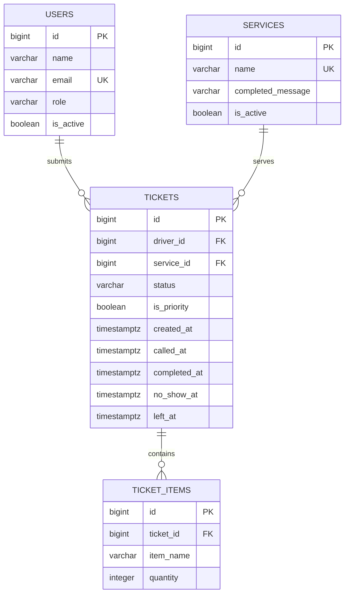

# WarehouseQ database schema

This is the proposed schema for WarehouseQ's warehouse receiving workflow. It models the current queue and the warehouse-specific requirements, including stored item lines and the planned service-management, priority, and no-show reporting features. The `users` table stores driver and staff profiles. Each ticket belongs to the driver who submitted it; staff action auditing is not included in this version.

## Find the nouns in the requirements

Each requirement marked **Stores data? = Yes** in [the requirements list](../requirements.md) is included below. The queue and the number of people ahead are derived from tickets, they are not stored as separate records or columns.

| Req ID | Requirement | Nouns | Table or column? |
| --- | --- | --- | --- |
| REQ-C01 | A driver can join the To Check or To Ship queue by entering their name and the items and quantities for the request. | **driver**, **queue**, **service**, **name**, **items**, **quantities**, **request** | **driver** → `users`, referenced by `tickets.driver_id`<br> **queue** → computed from `tickets`<br> **service** → `services`, referenced by `tickets.service_id`<br> **request** → `tickets`<br> **items** → `ticket_items.item_name`<br> **quantities** → `ticket_items.quantity` |
| REQ-C02 | A driver can view their ticket number, selected service, current status, and how many people are ahead in that service. | **ticket number**, **service**, **status**, **people ahead** | **ticket number** → `tickets.id`<br> **service** → `tickets.service_id` and `services.name`<br> **status** → `tickets.status`<br> **people ahead** → computed from earlier waiting tickets for the same service |
| REQ-C03 | A driver can tell when staff have called their ticket by seeing its status change to Processing on the ticket page. | **driver**, **staff**, **ticket**, **status** | **driver** and **staff** → `users` (`role` identifies each type)<br> **ticket** → `tickets`<br> **status** → `tickets.status` and `tickets.called_at` |
| REQ-S01 | A warehouse staff member can view waiting tickets in ticket-number order on the staff dashboard. | **staff member**, **tickets**, **ticket-number order** | **staff member** → `users` (`role = 'staff'`)<br> **tickets** → `tickets`<br> **ticket-number order** → generated `tickets.id` |
| REQ-S02 | A warehouse staff member can identify whether each ticket is for To Check or To Ship from its service label. | **staff member**, **ticket**, **service**, **service label** | **ticket** → `tickets`<br> **service** and **service label** → `services`, referenced by `tickets.service_id` |
| REQ-S03 | A warehouse staff member can call the next waiting ticket and update its status to Completed or No-Show from the dashboard. | **staff member**, **ticket**, **status**, **call**, **service** | **staff member** → `users` (`role = 'staff'`)<br> **ticket** and **status** → `tickets`<br> **call**, completion, and no-show times → `tickets.called_at`, `tickets.completed_at`, `tickets.no_show_at`<br> **service** → `tickets.service_id` |
| REQ-S04 | WarehouseQ can save services, tickets, item names, quantities, and statuses so the queue is still available after the server restarts. | **services**, **tickets**, **item names**, **quantities**, **statuses**, **queue** | **services** → `services`<br> **tickets** and **statuses** → `tickets`<br> **item names** and **quantities** → `ticket_items`<br> **queue** → computed from stored tickets |
| REQ-C04 | A driver can review the item names and quantities on their ticket after joining the queue. | **driver**, **item names**, **quantities**, **ticket** | **driver** → `users`, referenced by `tickets.driver_id`<br> **ticket** → `tickets`<br> **item names** and **quantities** → `ticket_items` |
| REQ-C05 | A driver can mark a request as time-sensitive so staff can identify it on the dashboard and prioritize it within its service. | **driver**, **request**, **priority**, **staff**, **service** | **driver** and **staff** → `users` (`role` distinguishes each type)<br> **request** → `tickets`<br> **priority** → `tickets.is_priority`<br> **service** → `tickets.service_id` |
| REQ-S05 | A warehouse staff member can add a service, rename it, or switch it off so drivers cannot select it for new tickets. | **staff member**, **service**, **name**, **active state**, **drivers** | **staff member** and **drivers** → `users` (`role` distinguishes each type)<br> **service**, **name**, and **active state** → `services.id`, `services.name`, and `services.is_active` |
| REQ-S06 | A warehouse staff member can see the number of No-Show tickets for each service on a selected day. | **staff member**, **No-Show tickets**, **service**, **day**, **number** | **staff member** → `users` (`role = 'staff'`)<br> **tickets** → `tickets`<br> **service** → `tickets.service_id`<br> **day** → `tickets.no_show_at` (`timestamptz`)<br> **number** → computed count, not stored |

## Tables and columns

Four related tables are needed. `users` stores driver and staff profiles. A ticket is one warehouse request associated with one driver, and each item/quantity pair is a separate row so tickets can contain any number of items.

| Table | Columns |
| --- | --- |
| `users` | `id`, `name`, `email`, `role`, `is_active` |
| `services` | `id`, `name`, `completed_message`, `is_active` |
| `tickets` | `id`, `driver_id`, `service_id`, `status`, `is_priority`, `created_at`, `called_at`, `completed_at`, `no_show_at`, `left_at` |
| `ticket_items` | `id`, `ticket_id`, `item_name`, `quantity` |

The driver's profile is stored once in `users`; `tickets.driver_id` identifies which driver submitted each request. The `role` column distinguishes drivers from staff, while `is_active` allows an account to be disabled without deleting its ticket history. The foreign key guarantees the referenced user exists; the application must also validate that the user's role is `driver` and the account is active before creating a ticket. Staff accounts are stored for staff access, but this design does not record which staff member performed each ticket status transition. Service details are kept separately so a service can be renamed or disabled without copying its name to every ticket. Ticket item names and quantities are kept in `ticket_items`, one row per item line.

The ticket status uses `Waiting`, `Processing`, `Completed`, `No-Show`, or `Left`. `Left` distinguishes a driver who leaves the queue from a driver who fails to appear, allowing no-show reports to count only actual no-shows. `is_priority` supports the future priority feature. `is_active` supports disabling a service while retaining it for historical tickets.

Queue position and counts are computed, not stored. To match REQ-S01 and the current app, waiting tickets are ordered by ticket number (`tickets.id`), a driver's position is the count of earlier `Waiting` tickets for the same service with a lower ticket number. `created_at` records when the ticket joined and supports date-based reporting, but does not determine ticket order. The no-show count is computed from `tickets.no_show_at` for the selected service and day.

## PostgreSQL types and constraints

`GENERATED ALWAYS AS IDENTITY` columns are generated by PostgreSQL. All timestamp columns use `timestamptz`; nullable transition times are filled when that transition occurs. `services.created_at` and `users.created_at` are omitted because no current or planned requirement needs those creation times.

| Table | Column | PostgreSQL type | Constraint | Why |
| --- | --- | --- | --- | --- |
| `users` | `id` | `bigint GENERATED ALWAYS AS IDENTITY` | PRIMARY KEY | Stable generated identifier for each driver or staff account. |
| `users` | `name` | `varchar(120)` | NOT NULL | Display name for the driver or staff member. |
| `users` | `email` | `varchar(254)` | NULL allowed, UNIQUE | Stores an email when provided; multiple legacy profiles can have no email without inventing account details. |
| `users` | `role` | `varchar(20)` | NOT NULL, CHECK (`role` IN (`'driver'`, `'staff'`)) | Distinguishes driver and staff permissions/types. |
| `users` | `is_active` | `boolean` | NOT NULL DEFAULT `true` | Disables an account without deleting its ticket history. |
| `services` | `id` | `bigint GENERATED ALWAYS AS IDENTITY` | PRIMARY KEY | Stable generated identifier for each service. |
| `services` | `name` | `varchar(80)` | NOT NULL, UNIQUE | Required service label, prevents duplicate labels such as two `To Check` services. |
| `services` | `completed_message` | `varchar(250)` | NOT NULL | Stores the service-specific completion message shown to the driver. |
| `services` | `is_active` | `boolean` | NOT NULL DEFAULT `true` | Inactive services stay available for old tickets but cannot be chosen for new ones. |
| `tickets` | `id` | `bigint GENERATED ALWAYS AS IDENTITY` | PRIMARY KEY | Unique ticket number generated by the database. |
| `tickets` | `driver_id` | `bigint` | NOT NULL, FOREIGN KEY REFERENCES `users(id)` ON DELETE RESTRICT | Associates the request with its driver and preserves ticket ownership history. |
| `tickets` | `service_id` | `bigint` | NOT NULL, FOREIGN KEY REFERENCES `services(id)` ON DELETE RESTRICT | Every ticket must belong to an existing service, deleting a service cannot erase ticket history. |
| `tickets` | `status` | `varchar(20)` | NOT NULL DEFAULT `'Waiting'`, CHECK (`status` IN (`'Waiting'`, `'Processing'`, `'Completed'`, `'No-Show'`, `'Left'`)), plus the table-level status/timestamp CHECK below | Restricts ticket state to valid queue states and requires transition timestamps to agree with the state. |
| `tickets` | `is_priority` | `boolean` | NOT NULL DEFAULT `false` | Stores whether this individual request has priority, it can vary per ticket. |
| `tickets` | `created_at` | `timestamptz` | NOT NULL DEFAULT `now()` | Records when the ticket joined and supports date-based reporting. |
| `tickets` | `called_at` | `timestamptz` | NULL allowed | Records when the ticket was called, NULL until called. |
| `tickets` | `completed_at` | `timestamptz` | NULL allowed | Records when staff completed the work, NULL unless completed. |
| `tickets` | `no_show_at` | `timestamptz` | NULL allowed | Records when staff marked a no-show, supports per-service, per-day reports. |
| `tickets` | `left_at` | `timestamptz` | NULL allowed | Records when a driver left before being called, separately from a no-show. |
| `ticket_items` | `id` | `bigint GENERATED ALWAYS AS IDENTITY` | PRIMARY KEY | Gives each item line its own stable identifier. |
| `ticket_items` | `ticket_id` | `bigint` | NOT NULL, FOREIGN KEY REFERENCES `tickets(id)` ON DELETE CASCADE | Associates the item line with its ticket; ticket items have no meaning without their ticket. |
| `ticket_items` | `item_name` | `varchar(120)` | NOT NULL | Stores one item description per row. |
| `ticket_items` | `quantity` | `integer` | NOT NULL, CHECK (`quantity` > 0) | Stores a numeric, positive item quantity. |

This schema uses PRIMARY KEY, FOREIGN KEY, NOT NULL, UNIQUE, CHECK, and `timestamptz`. Ticket positions, counts, and service queues are query results rather than stored values.

The `users` table has a CHECK constraint limiting account roles:

```sql
CONSTRAINT ck_users_role CHECK (role IN ('driver', 'staff'))
```

The `tickets` table has a second CHECK constraint to prevent status and transition timestamps from contradicting each other:

```sql
CONSTRAINT tickets_status_timestamps_check CHECK (
    (status = 'Waiting'
        AND called_at IS NULL AND completed_at IS NULL
        AND no_show_at IS NULL AND left_at IS NULL)
 OR (status = 'Processing'
        AND called_at IS NOT NULL AND completed_at IS NULL
        AND no_show_at IS NULL AND left_at IS NULL)
 OR (status = 'Completed'
        AND called_at IS NOT NULL AND completed_at IS NOT NULL
        AND no_show_at IS NULL AND left_at IS NULL)
 OR (status = 'No-Show'
        AND called_at IS NULL AND completed_at IS NULL
        AND no_show_at IS NOT NULL AND left_at IS NULL)
 OR (status = 'Left'
        AND called_at IS NULL AND completed_at IS NULL
        AND no_show_at IS NULL AND left_at IS NOT NULL)
)
```

## Entity relationship diagram



**Relationships:** One driver user can submit many tickets; each ticket belongs to exactly one driver. One service has many tickets; each ticket belongs to exactly one service. One ticket can have many item lines; each item line belongs to exactly one ticket. Staff users are stored in `users`, but staff-to-ticket action history is not part of this schema.

**Foreign-key deletion behavior:**

- `tickets.service_id` references `services.id` with **ON DELETE RESTRICT**. A service with ticket history cannot be deleted, preserving reports and old requests. Staff can switch it off with `services.is_active` instead.
- `tickets.driver_id` references `users.id` with **ON DELETE RESTRICT**. A user with ticket history cannot be deleted, preserving the identity associated with old requests. Deactivate the user with `users.is_active` instead.
- `ticket_items.ticket_id` references `tickets.id` with **ON DELETE CASCADE**. Item lines are dependent details of a ticket and should not remain as orphan rows if a ticket is deleted.

There are no many-to-many relationships in this version of WarehouseQ.

## Normalization check

1. **One value per cell (1NF):** Yes. Each ticket item and quantity is one `ticket_items` row. A ticket does not contain a comma-separated list of item names or quantities.
2. **Depends on the whole key (2NF):** There is no join table with a composite key. Every non-key column in each table describes its row's primary key, the fields in `ticket_items` describe that item line.
3. **No hidden copies (3NF):** Service name and completion message are stored once in `services`, rather than repeated on every ticket. Driver names and emails are stored once in `users`, and tickets reference the driver by `driver_id`. Each item line belongs to one ticket.